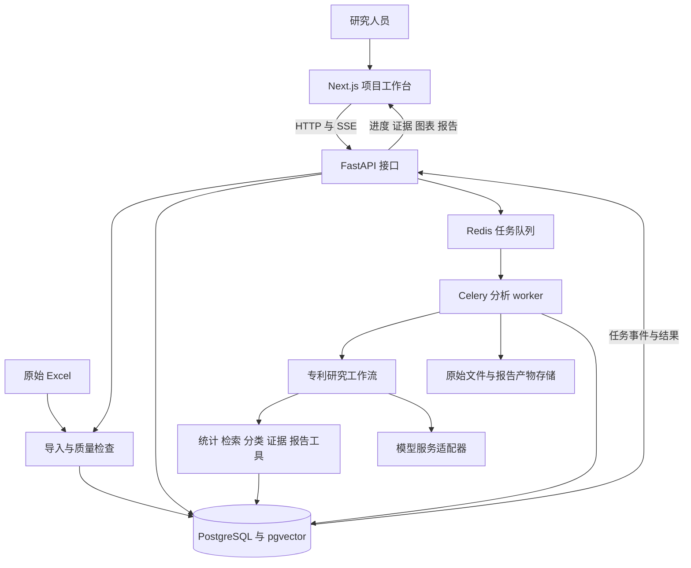

# PatentCompass 总体架构与样本验证方案

日期：2026-10-19

状态：架构提案，供后续实现评审。现有系统仍为静态交互原型。

依据：当前产品说明、当前原型、`database/patent-demo.xlsx`，以及校企项目当前工作区的创新引擎代码。

## 1 核心判断与验证目标

可以基于现有 Excel 验证产品。它适合支撑“导入真实专利样本 → 确认范围 → 计算统计 → 技术主题分析 → 带依据的问答 → 报告生成与修改”的完整流程。

Excel 作为原始数据来源保留，应用运行时导入数据库。数据库同时保存项目、对话、数据版本、分析任务、证据和报告版本，避免每轮对话重新读取文件或把整张表交给模型。

首个案例建议命名为“无人机专利检索样本分析”，标注“中国地区筛选，部分结果”。长期产品继续保持“行业专利导航”，中国范围和全球主要布局对照在补齐相应数据后启用。下载网站、原始地区筛选、申请人所在国、公开机构和保护地域需要分别记录；当前文件的公开编号属于 WO，地区筛选条件不能直接代替文献的公开机构。

本方案按小团队开发、单一领域和少量内部试用者设计。用户已确认当前采用混合开发：Next.js 和 FastAPI 在本地运行，数据库、Redis 与 Celery worker 使用 Docker，模型先调用外部 API。具体预算、版本和模型供应商仍待实施时确定；核心流程稳定后再形成完整容器化的演示与部署环境。

### 问题与解决方向

- 当前只有交互示例：接通一条真实数据到报告的流程，保留现有项目和报告体验。
- 已确认为部分检索结果：保存原始筛选与导出说明，所有统计明确限定在导入样本内。
- 统计容易被模型编造：由数据库查询与确定性计算产生数字，模型引用结果解释。
- 机会方向容易过度推断：先记录候选方向、反例与待补检事项，补充数据后再更新判断。
- 参考平台依赖较多：迁移通用组件与契约，独立实现专利业务与数据访问层。

## 2 Excel 实际数据审计

文件：`database/patent-demo.xlsx`。工作表为 `Sheet1`，实际区域 `A1:M521`，含表头和 520 条非空数据记录。

| 项目 | 本次核查结果 | 对产品的影响 |
| --- | --- | --- |
| 字段 | 13 列 | 足够启动著录信息和摘要分析 |
| 申请记录 | 520 条，原始申请号各不相同 | 可按申请计数，不能称为 520 件授权专利 |
| 公开文献标识 | 6 行含两个公开编号，拆分后共 526 个唯一编号 | 申请和公开文献记录必须分别建模 |
| 公开机构 | 526 个公开编号全部以 WO 开头 | 是 PCT 国际公布样本，不能当作中国国内专利全集 |
| 申请号格式 | 520 条均为 `WO…CN…` 导出格式，如 `WO2019CN91848` | 原号完整保留，标准标识转换需单独验证 |
| 申请日期 | 2009-03-27 至 2026-04-24 | 可计算样本年度申请分布 |
| 公开日期 | 拆分多值后为 2010-09-30 至 2026-09-10 | 区分公开年、申请年及近期公开滞后 |
| 标题与摘要 | 520 条均有英文内容，未检出汉字 | 需要中文问题到英文原文的检索与引用 |
| IPC | 520 条非空；339 条含 B64U | 可做 IPC 分布与技术分类辅助 |
| 申请人所在国 | 518 行为 CN，另有 `JP;CN`、`CN;TJ` 各一行 | 只有国家信息，无法制作真实中国省市分布 |
| 文献类型 | 520 行全部为空 | 保留缺失；公开编号的种类代码另行解析 |
| 权利要求与说明书 | 不存在 | 仅支持基于摘要的技术理解与线索分析 |
| 法律状态、同族标识、国家阶段、引用关系、来源链接 | 不存在独立字段 | 不启用依赖这些字段的真实统计与结论 |

全部字段为：申请号、公开（公告）号、申请日、公开（公告）日、IPC分类号、申请（专利权）人、发明人、发明名称、优先权号、优先权日、文献类型、申请人所在国（省）、摘要。文献类型以外的 12 列均为 520/520 非空；“非空”不等于字段含义和对应关系已完全校验。

公开编号的种类代码为 A1 518 个、A2 2 个、A3 2 个、A8 1 个、A9 3 个。这些代码不能用来代替授权状态或当前有效性判断。优先权日有 11 行多值，拆分后 533 个日期，范围为 2009-03-27 至 2026-01-07；优先权记录不等于可靠的同族定义。

526 个编号来自 520 行，实际只有 520 份行级标题和摘要。没有为每个拆分后的编号取得独立摘要或正文，因此摘要证据关联原始申请行；不把同一行拆出的多个编号当成多份独立语义证据。

### 样本偏差与清洗事项

1. 按申请人原名分号拆分、行内去重，`SZ DJI TECHNOLOGY CO LTD` 出现在 192 条申请中，占样本 36.92%。同集团的其他名称尚未合并，不能据此推算行业市场份额或集团全量布局。
2. 在标题或摘要中按 `无人机|无人驾驶航空器|unmanned\s+aerial|\buav\b|\buavs\b|\bdrone\b|\bdrones\b` 忽略大小写匹配，命中 459/520 条。其余 61 条包含云台、移动平台、电池等内容，需要人工核查技术相关性；不能按这一条正则直接删除。
3. 日期均为字符串；6 行公开日期为分号多值，标题带末尾换行。需要清理空白、拆分多值、解析日期，并保留原值和原行号。
4. 2024、2025、2026 年申请记录分别为 18、42、14 条。这个分布只能说明导入样本，不足以判断无人机行业年度增长或衰退。
5. 用户已确认：检索主要使用“无人机”，源系统地区筛选为“中国”，当前文件不是全部检索结果。完整检索式、地区筛选具体对应的字段、命中总量、部分结果的选择方式和导出时间尚未确认。将“中国”保存为原始检索条件，不直接改写为所有记录的公开机构或保护地域；文件内全部 WO 编号仍按实际值保留。2026 年也不是完整年度。

原文件 SHA256：`37ad6eed21a4d5a68194af1cb8fd03ccde7ef7ed21a4dcdfb159fcfe23dfa480`。本次只读检查未修改原文件。

### 能力启用边界

| 第一轮可验证 | 补数据后再验证 |
| --- | --- |
| 导入、质量检查、申请与公开文献计数 | 中国国内专利覆盖与全球同口径对照 |
| 样本年度、申请人、IPC 分布 | 真实省市地图、国家阶段与海外保护布局 |
| 英文摘要检索与中文问答 | 权利要求比较与重点专利保护范围解读 |
| 人工可修订的技术分类、代表专利 | 同族、法律事件、有效保护地和引用网络 |
| 有依据的专题简报、追问和版本 | 扩大数据范围后的行业导航及外部补检 |
| 样本低覆盖方向和待补检任务 | 经补检、反例与专业复核的候选布局建议 |

WIPO 对 WO 国际公布编号和 PCT 阶段的说明见[申请人指南](https://pctlegal.wipo.int/eGuide/view-doc.xhtml?advancedBrowsing=true&doc-code=pctip&doc-lang=en&doc-type=guide)。WO 记录本身不能证明已进入某国国家阶段或在该国获得有效保护。

## 3 产品结构与首版范围

沿用当前产品的“项目—研究对话—分析工作台—导航报告”组织方式。无人机作为首个验证案例，领域名称保持用户可选；首版实际执行限于已导入数据，不承诺其他领域有数据。

| 位置 | 核心内容 | 首版行为 |
| --- | --- | --- |
| 项目列表 | 领域、研究问题、数据准备情况、最近报告 | 新建和进入项目 |
| 研究对话 | 范围确认、提问、任务进度、证据卡片 | 真实调用检索、统计与报告工具 |
| 范围与目标 | 技术边界、时间、申请人、数据覆盖 | 确认后形成范围版本，修改后标记旧分析需更新 |
| 数据与证据 | Excel 导入、质量报告、专利列表、原文定位 | 独立数据导入入口，不能以 Word 附件元数据代替导入完成 |
| 态势分析 | 样本年度、申请人、IPC、技术主题 | 图表点击可查看对应完整记录集合 |
| 概览 | 主要发现、证据不足项、下一步行动 | 由真实分析结果生成，保留缺失状态 |
| 布局与路线图 | 候选方向、反例、补检与验证任务 | 首轮只形成待验证方向和行动计划 |
| 导航报告 | 正文、图表、引用、版本与差异 | 先交付短专题报告，再扩展完整章节 |

同项目的多个对话共享研究范围、数据和底稿，对话消息各自保存。报告版本属于项目，并固定引用生成时的数据、范围与图表。旧版本浏览、切回旧版和继续修改沿用现有原型语义。

首版保留地理与长期布局相关页面，但字段不足时显示缺失原因与补充任务。现有模拟图表、虚构主体和示例报告继续明确标注，不能写入真实分析结果。

## 4 总体系统架构

建议采用模块化单体：一个独立后端代码库，按业务模块划分；API 和后台 worker 使用同一套业务代码，以不同进程运行。前端独立部署。



PostgreSQL 保存业务数据、分析结果和任务事件；Redis 负责队列与短期通知，不能成为报告和证据的唯一存储。原始文件、图表导出和报告文件保存在持久化目录。模型只通过后端调用。

### 技术选型

| 层级 | 建议 | 原因与边界 |
| --- | --- | --- |
| 前端 | Next.js App Router、React、TypeScript | 与参考项目一致，便于迁移 React 交互；分析业务统一在 FastAPI |
| 样式与状态 | Tailwind CSS、Zustand | 复用参考项目经验；服务端数据以接口为准，本地只保留视图状态和草稿 |
| 图表 | Apache ECharts | 年度、排行、热力图和技术树使用统一图表组件 |
| 报告编辑 | Tiptap，保存结构化 JSON | 支持段落定位、引用和局部更新；首轮先实现阅读及受限段落修改 |
| 后端 | Python、FastAPI、Pydantic | 文件处理、数据分析和智能体调用集中在同一语言 |
| 数据访问 | SQLAlchemy、Alembic | 明确模型与数据库迁移，复用业务概念而非复制原 MySQL DDL |
| 主数据库 | PostgreSQL | 同时存关系数据、JSON 结果、版本和任务信息 |
| 语义检索 | pgvector | 与主库统一管理；当前小样本可精确向量检索，测量后再加近似索引 |
| 中文到英文检索 | 双语关键词扩展、字段过滤、跨语言 embedding | 原始英文保留，中文译文作为派生字段并注明生成来源 |
| Excel 处理 | openpyxl 读取，Python 规则清洗 | 保留原始文件和多值关系；统计可用 SQL 或 pandas 纯计算 |
| 后台任务 | Celery、Redis | 导入、批量分类和长报告离开请求进程执行，保存可恢复步骤 |
| 模型 | 一个对话模型、一个中英跨语言 embedding 模型 | 先用标注样本评估，不预设供应商，也不训练专用大模型 |
| 文件与导出 | 持久化本地目录；python-docx 导出 Word | 先验证引用和图文一致性，PDF 排版与对象存储按后续需求扩展 |
| 开发与部署 | 当前混合开发，后续完整容器化 | 本地运行前端与 API；Compose 管理数据库、Redis 和 Linux worker；演示与服务器部署再统一容器化 |
| 验证与观测 | pytest、前端组件测试与 Playwright 关键流程、结构化日志 | 记录运行 ID、工具耗时、模型用量、失败步骤和引用校验结果 |

前端的对话、图表和编辑器属于交互组件，按 Next.js 的客户端边界组织；不在 Next.js 再建一套专利分析后端。[Next.js 文档](https://nextjs.org/docs/app/getting-started/server-and-client-components)

FastAPI 文档建议重型后台工作考虑 Celery 等独立任务工具；这里采用队列主要为长任务的独立运行与恢复，实际恢复仍需业务状态和幂等设计。[FastAPI 文档](https://fastapi.tiangolo.com/tutorial/background-tasks/)、[Celery 任务文档](https://docs.celeryq.dev/en/stable/userguide/tasks.html)

pgvector 默认提供精确最近邻检索，适合先验证小样本。关键词搜索先使用字段过滤和中英文词组匹配；需要索引时评估 `pg_trgm`，不能把默认全文检索直接等同于中文分词搜索。[pgvector 文档](https://github.com/pgvector/pgvector)、[PostgreSQL 文档](https://www.postgresql.org/docs/current/pgtrgm.html)

具体版本在工程初始化时锁定兼容组合。参考项目版本和本地缓存可作为候选，不能直接复制其全部依赖清单。

### 数据库选型澄清

当前仓库尚未实现后端和业务数据库。这里推荐的主数据库是 PostgreSQL，参考项目使用的是 MySQL；不能把建议方案写成已经部署的事实。

MySQL 同样能保存专利、项目、消息、统计和报告版本。若后续明确优先沿用 MySQL，则采用 MySQL 保存业务数据与字段/关键词索引，Qdrant 保存语义向量，保持相同的业务接口。当前仍保留 PostgreSQL 与 pgvector 的推荐，主要考虑将关系数据和向量索引放在同一数据库，减少独立服务及同步工作；智能体流程不依赖某一种数据库品牌。

MySQL 的英文全文索引和面向中日韩文本的 ngram 解析器属于关键词检索能力，不能直接替代跨语言语义检索。[MySQL 全文检索](https://dev.mysql.com/doc/refman/8.4/en/fulltext-natural-language.html)、[ngram 解析器](https://dev.mysql.com/doc/refman/8.4/en/fulltext-search-ngram.html)

### 图表渲染 插入与排版

| 工作 | 负责模块 | 保存内容 |
| --- | --- | --- |
| 计算年度、申请人和分支数量 | 后端统计工具 | 数据版本、筛选范围、计数口径、结果表 |
| 选择图型、生成规范配置 | 图表配置工具及受约束的模型建议 | 图表类型、维度、指标、标题和样式参数 |
| 绘制与交互 | ECharts | 从已计算数据生成的图形 |
| 插入报告和调整位置 | Tiptap 图表节点与报告内容模型 | 图表 ID、所在章节、宽高、图题、来源和版本 |
| 正文与整页排版 | 报告组件、CSS 和导出模板 | 章节顺序、字号、间距、分页与页眉页脚 |

ECharts 负责图形内部的坐标轴、图例、标签和绘制；章节编排、正文、图文位置及 Word/PDF 分页由报告系统处理。报告编辑器的自定义节点可以承载交互图表，但插入、尺寸调整和持久化仍需实现相应组件。[Tiptap Node Views](https://tiptap.dev/docs/editor/extensions/custom-extensions/node-views)

网页报告通过图表节点引用固定版本的配置与数据并渲染。Word 导出先把同一版本图表渲染为 PNG，再由文档模板插入图题、来源和正文；PDF 后续从冻结报告布局导出。ECharts 支持服务端 SVG 和 Canvas 渲染，不能只保存浏览器当前显示的图像而丢弃数据与配置。[ECharts 渲染文档](https://echarts.apache.org/handbook/en/how-to/cross-platform/server/)

## 5 后端模块与数据模型

### 业务模块

1. `projects`：项目、范围版本和当前研究底稿。
2. `datasets`：导入批次、字段映射、覆盖说明和质量报告。
3. `patents`：申请、公开文本、优先权与原始字段，申请人名称映射。
4. `search`：字段筛选、关键词和语义召回、证据定位。
5. `analytics`：申请与公开计数、年份、申请人、IPC、技术主题矩阵。
6. `research`：对话意图、工作流状态、任务步骤和待人工确认事项。
7. `evidence`：摘要片段、计算依据、反例与结论引用。
8. `reports`：报告章节、图表、版本、局部修改与导出。

这些是同一后端内部模块，不拆为八个服务。

### 核心实体

| 实体 | 最小责任 |
| --- | --- |
| `datasets / dataset_versions` | 原文件散列、导入规则版本、检索说明、覆盖范围和实际数量 |
| `patent_applications` | 按数据版本保存申请记录、原申请号、标题、摘要、日期及原始行 |
| `patent_publications` | 每个公开编号一条著录记录，与申请关联，保存对应公开日和种类代码 |
| `projects / scope_versions` | 项目资料、当前范围、选用数据版本和冻结的筛选条件 |
| `conversations / messages` | 独立对话记录、引用上下文和关联运行 |
| `research_runs / run_steps / run_events` | 运行范围快照、阶段结果、重试与递增事件序号 |
| `analysis_results` | 统计表、技术分类、图表数据和对应规则版本 |
| `evidence_items` | 专利字段与文本位置，或统计结果与计数口径 |
| `reports / report_versions` | 结构化正文、图表、证据、父版本和生成快照 |

首版申请人、IPC、发明人和优先权可用结构化数组存储；需要精细实体管理时再拆关系表。数据版本内按申请号约束申请唯一性，公开编号独立约束；跨批次合并按明确规则处理，不因重新导入覆盖历史报告所用数据。

每条原始记录保留 `source_file_hash`、`source_sheet`、`source_row`、`raw_record`、清洗规则版本和字段异常。6 行复合公开编号必须拆开，核验编号与日期的对应关系。不能把整个分号字符串当成单个公开编号。

### 导入流程

```text
保存原文件与散列
→ 确认表头和字段映射
→ 清理空白并解析日期、多值及编号
→ 生成申请记录和公开文献著录记录
→ 输出重复、缺失、日期与多值异常
→ 确认数据覆盖说明
→ 保存数据版本
→ 生成检索文本与可选向量
```

只有质量检查完成的数据版本可用于正式分析。不能解析的行保留在异常清单，不静默丢弃。重复导入同文件和同规则时提示已有版本，重新处理产生新版本。

### 统计与证据规则

- 默认按申请计数，图表明确使用申请年还是公开年；公开文献计数为独立视角。
- 共同申请人首版采用全计数：一条申请可以分别计入多个申请人，各申请人数量相加可大于总申请数。展示和导出使用同一口径。
- IPC 允许多标签，分布不要求各类合计等于申请总数。技术分类单独保留“待分类”和人工修订记录。
- 年度、申请人等全景统计必须覆盖当前范围内的全部入选记录。证据检索的前若干条只用于召回和展示。
- 同名清理与集团合并分开：空白、大小写可规范化；别名与集团关系需要依据和确认。
- 摘要证据保留原文、字段名、片段位置和数据版本。统计证据保存筛选条件、计数单位、日期字段及结果 ID。
- 展示译文时同时能回看英文原文；检索无结果返回当前样本未命中，不扩写成行业不存在。

## 6 智能体工作流

首版采用一个研究助手协调明确的阶段与工具。将参考项目的规划、任务、事件和报告思路收敛为专利研究流程，先不复制完整通用智能体运行平台。

```text
理解研究问题
→ 确认范围与可用数据
→ 筛选、清洗检查
→ 确定性统计
→ 技术主题与代表专利
→ 候选方向、反例与证据缺口
→ 编制报告
→ 核对引用与图文数字
→ 形成报告版本
```

普通统计追问直接调用相应工具，不重复生成整份报告。任务可停在“等待范围确认”“等待补充数据”或“等待人工复核”，并展示已经完成的结果。

### 专利检索的实现

首版的检索对象是导入数据库的样本；外部专利库检索作为独立数据源能力，接通后再启用。

| 检索层 | 具体方式 | 使用场景 |
| --- | --- | --- |
| 编号与字段检索 | 数据库精确查询、日期与申请人筛选、IPC 条件 | 查某件专利，限定时间或主体，计算统计 |
| 关键词检索 | 中英文术语扩展、标题与摘要词组匹配，必要时增加全文索引 | 找明确出现某技术词的记录 |
| 语义检索 | 跨语言 embedding 与 pgvector 相似度查询 | 中文问题检索英文摘要，寻找不同措辞的相近方案 |
| 结果融合 | 合并候选、按申请 ID 去重、结合匹配与相关性排序 | 返回用于阅读和回答的代表证据 |
| 外部检索 | 后续接入一个已验证的授权 API 或导入新增结果 | 扩大数据、补检反例、补充全文与法律信息 |

例如“无人机自主降落有哪些技术路线、主要申请人是谁”，助手先把需求转为中英文技术词和筛选参数，再调用检索工具定位有关记录。对选定范围进行技术分类并记录人工修订后，数据库统计各路线与申请人，模型依据结果解释差异并引用摘要。

如果问题是“分析当前无人机样本整体”，则对入选的全部 520 条申请分批分类和汇总，不用语义检索前十条替代整体。特定技术主题的统计也必须固定完整入选集合与分类规则；召回候选的前若干条仅是阅读证据，不自动成为该主题的全量统计总体。

当前可用文件导入完成第一轮数据接入；国家知识产权局的网页检索与下载功能不等同于已经取得可供本产品调用的开放 API。后续可评估授权数据接口，EPO OPS 是机器接口候选之一，但须核实覆盖、认证与实际返回字段。[国家知识产权局系统介绍](https://www.cnipa.gov.cn/art/2023/2/13/art_3166_182074.html)、[EPO OPS](https://www.epo.org/en/searching-for-patents/data/web-services/ops)

### 从说明到可执行编排

编排采用明确阶段加条件分支：范围不足先澄清，证据不足扩展检索，有反例则修正判断，统计或引用校验失败则回到对应步骤。每步保存输入、工具回执、结果和版本，重试有次数和成本上限。

| 产品说明中的动作 | 对应工具与产物 | 执行条件 |
| --- | --- | --- |
| 检索 | 范围规划、字段与混合检索，产生记录集合和检索日志 | 首版搜索导入样本，外部检索需接入数据源 |
| 总结 | 按批提取问题、方法、应用场景，保留摘要出处 | 英文摘要足以形成初步总结 |
| 分析 | 统计工具与技术分类，产生表格、矩阵和代表记录 | 覆盖全部入选集合，核对分类与计数 |
| 梳理 | 主题归并、路线组织与有依据的章节 | 归纳结论可回到记录与计算结果 |
| 候选方向与验证 | 覆盖矩阵、反例检索和修订日志 | 当前仅内部补检，外部补检保留待执行 |
| 制图与写报告 | 图表配置、ECharts、报告编排与引用校验 | 同一数据快照，图文数字一致 |

这套流程可以实现产品说明中的检索、总结、分析和梳理。编排的作用是组织真实工具和校验，而缺失的权利要求、法律事件、地域及全量数据仍需通过数据源补齐；当前仍为待实现方案。

### 模型与程序职责

| 模型负责 | 程序负责 |
| --- | --- |
| 研究问题理解、范围草案 | 参数校验、权限、范围冻结 |
| 中英文术语扩展、摘要理解 | 关键词与向量检索、记录过滤 |
| 技术分类建议与解释 | 分类结果保存、人工修订和汇总 |
| 候选方向与报告草稿 | 数字计算、证据存在性和引用校验 |
| 指定段落的修改建议 | 基础版本检查、新版本保存和差异计算 |

工具建议包括 `search_patents`、`get_patent`、`compute_statistics`、`classify_patents`、`find_counterexamples`、`build_report`、`revise_report`。全部接收结构化参数，只能调用允许的查询和计算；不向模型开放任意 SQL、Shell 或可执行图表代码。

每次运行保存数据版本、范围版本、模型与提示模板版本、工具输入输出引用及已完成步骤。模型按批次读取摘要或检索片段；数字从统计结果注入，不由模型重新估算。embedding 记录模型、维度和文本散列，模型切换时重建相应向量。

### 候选方向与补检

当前 Excel 阶段只能执行样本内部的同义词扩展、相邻技术查找和反例检索。候选记录保存支持证据、反例、未覆盖的问题和下一步检索式。

没有外部数据通道时，外部补检明确保持待执行。之后导入补检结果或接通授权接口，再生成新的数据与分析版本。摘要未提及某场景不能用来证明权利要求未覆盖该场景。

后续仅为一个实际可用的数据源增加适配器；文件导入、外部检索与全文补充都转换为同一内部记录格式。接口搜索与现有数据集内部搜索在结果中分别标识。

## 7 任务流式交互与报告版本

### API 覆盖评审

原 12 个接口是主要任务的入口草案，尚未覆盖前端所需的完整操作。项目列表、历史对话、范围编辑、数据集绑定、分析结果读取、证据详情、报告版本选择和文件下载均需补充。不能把任务能启动或 SSE 能输出文字，等同于工作台和报告功能已闭环。

本节以当前产品说明和 `front-point/prototype/README.md` 为依据。前端原型已有交互但仍使用本地示例和存储，以下接口是设计提案，未实现或通过端到端验收。

| 前端功能 | 原接口覆盖情况 | 本轮补齐方式 |
| --- | --- | --- |
| 创建项目、项目列表、刷新进入项目 | 只有创建 | 项目列表和项目详情 |
| 新对话、历史列表、继续追问 | 只有向已有对话发消息，缺少对话创建与读取 | 首次发送时创建对话，读取历史和消息 |
| 自动提议范围、用户修改与确认 | 缺少保存、确认和等待后继续的约定 | 范围版本更新、运行补充输入 |
| Excel 导入、选用已有数据、质量检查 | 有导入和质量读取，缺少项目与数据版本关联 | 数据集列表和项目绑定 |
| 专利列表、图表下钻、摘要证据 | 只有列表 | 专利详情、版本化筛选和证据详情 |
| 概览、态势、技术分支、候选方向及路线图 | 缺少持久化结果读取 | 按分析运行读取工作台结果 |
| 任务进度、断线恢复、取消和重试 | 有基本状态和流，缺少确认续跑与手动重试 | 输入和重试入口，明确恢复规则 |
| 阅读报告、浏览版本、差异与切回 | 只有指定版本读取和修改入口 | 版本列表、当前采用版本更新、结构化差异所需数据 |
| 选中文字追问或修改 | 入口已有，缺少定位及基础版本契约 | 消息和修改请求携带引用与目标块 |
| 图表显示、放大、报告插图及排版 | 缺少图表产物读取和定位信息 | 图表快照读取，报告保存布局；交互操作由前端处理 |
| Word 导出与下载 | 只有导出任务创建 | 复用运行状态并返回可下载文件 |
| Word 资料正文、自由图表 AI 编辑、外部补检 | 原接口未形成完整约定 | 分阶段扩展，首轮不能标为已支持 |

### 首轮完整验证所需接口

以下 29 个操作保留原 12 个入口，并补齐读写闭环。接口数量不是验收标准；响应字段、状态转换和跨版本一致性同样需要实现。

#### 项目与研究范围

| 接口 | 用途与必要返回 |
| --- | --- |
| `POST /api/projects` | 创建项目，返回项目 ID；不自动生成空历史对话 |
| `GET /api/projects` | 分页读取项目列表与准备状态 |
| `GET /api/projects/{id}` | 读取项目、共享范围、数据绑定、最近对话、活动运行、当前分析及采用的报告版本引用 |
| `PATCH /api/projects/{id}/scope` | 修改或确认范围，基于期望范围版本创建新版本，返回受影响分析的过期状态 |

项目详情提供恢复页面所需的资源引用，不返回整份历史消息、全部专利和所有报告正文。折叠侧栏、当前页签和放大图表属于前端状态，不各设后端接口。

#### 数据集与专利

| 接口 | 用途与必要返回 |
| --- | --- |
| `GET /api/datasets` | 读取可选数据集和就绪版本概要 |
| `POST /api/datasets/imports` | 上传文件或选择已上传文件，返回导入运行及待处理数据版本 ID |
| `GET /api/datasets/{id}/quality` | 通过 `dataset_version_id` 读取指定版本的数量、字段映射、异常和覆盖说明 |
| `PUT /api/projects/{id}/datasets` | 绑定确认使用的数据版本集合，校验就绪状态并标记已有分析需更新 |
| `GET /api/projects/{id}/patents` | 分页筛选和检索，支持按分析或图表快照下钻 |
| `GET /api/projects/{id}/patents/{patent_id}` | 读取对应版本的编号、英文摘要、来源行、公开记录及现有证据 |

导入表格不自动表示该数据已进入某项目的分析范围。绑定必须指定版本，更新数据不得静默替换历史运行和报告的输入。原始检索条件、部分结果说明与实际字段覆盖随数据版本保存。

字段筛选的总数和语义召回候选数分开返回。语义前若干条使用 `returned_count`，不能冒充总体 `total`。从历史图表下钻时沿用该图表的数据版本、计数规则和筛选条件，不能查询当前最新版后声称是在解释旧图。

#### 对话与历史

| 接口 | 用途与必要返回 |
| --- | --- |
| `POST /api/projects/{id}/conversations` | 首次发送有效内容时提交 `initial_message`，原子创建对话和首条消息，返回对话、消息和运行 ID |
| `GET /api/projects/{id}/conversations` | 分页读取独立对话历史与标题 |
| `GET /api/conversations/{id}/messages` | 读取消息、引用、修改卡片和运行关联，支持刷新及分页 |
| `POST /api/conversations/{id}/messages` | 向已有对话发送消息，返回已保存消息与本次运行 ID |

点击“＋”只在前端打开草稿；首次发送才创建历史，保持原型语义。消息包括正文、资料引用及可选的 `report_version_id`、`block_id`、选中原文；仅引用到输入框不提交请求，真正发送时再保存。

#### 研究运行与人工确认

| 接口 | 用途与必要返回 |
| --- | --- |
| `POST /api/projects/{id}/runs` | 显式启动分析或报告，绑定确认范围及数据版本；返回运行 ID |
| `GET /api/runs/{id}` | 读取运行状态、当前步骤、待回答问题、错误及结果资源引用 |
| `GET /api/runs/{id}/events` | SSE 传输步骤、文本、证据和产物通知，支持按事件序号补读 |
| `POST /api/runs/{id}/inputs` | 针对待回答问题提交澄清、范围或分类复核；保存输入并继续原运行 |
| `POST /api/runs/{id}/cancel` | 请求停止，返回已记录的取消状态，保留已经完成的结果 |
| `POST /api/runs/{id}/retry` | 从失败运行创建关联重试运行，复用适用的已完成结果；输入范围变化时另建新分析 |

运行状态至少包括 `queued`、`running`、`waiting_input`、`succeeded`、`failed`、`cancelling` 和 `cancelled`。补充输入携带 `input_request_id` 与期望版本，避免把过期回答用于已变化的任务。恢复等待范围的运行时，由输入处理原子保存确认范围和续跑信息，不再要求前端额外启动一次相同分析。

消息入口与运行入口不是要求前端连续调用的两个步骤：对话中提出研究或修改要求，由消息服务创建对应运行并返回标识；工作台“开始分析”才直接调用运行入口。报告修改和导出入口同样在后端创建各自运行，避免重复执行。

#### 工作台 图表与证据

| 接口 | 用途与必要返回 |
| --- | --- |
| `GET /api/projects/{id}/analysis` | 通过 `run_id` 和 `view` 读取概览、趋势、主题、主体、候选方向和路线图等已保存结果 |
| `GET /api/charts/{id}` | 通过 `version_id` 读取图表数据、配置、计数口径、来源和下钻条件 |
| `GET /api/evidence/{id}` | 读取固定数据版本下的原文片段、位置或统计依据，并返回原始记录引用 |

分析响应携带 `analysis_id`、来源运行及数据和范围版本。没有结果时返回 `not_generated`，缺少字段时返回 `unavailable` 及原因，范围变化后返回 `stale` 并保留旧结果。候选方向与路线图作为分析结果读取，首版不为每个卡片单独建立 CRUD 接口。

SSE 事件用于实时更新和通知，刷新后的工作台仍从上述结果接口恢复。放大图表使用同一配置与数据；“带入对话”只在前端预填文字及引用，不额外产生运行。

#### 报告版本与导出

| 接口 | 用途与必要返回 |
| --- | --- |
| `GET /api/reports/{id}/versions` | 返回版本列表、父版本、指令、摘要、来源对话和当前采用版本 |
| `GET /api/reports/{id}/versions/{version}` | 读取不可变正文块、图表引用与布局、证据及数据快照 |
| `POST /api/reports/{id}/revisions` | 基于指定版本和目标块创建修改运行，返回运行 ID |
| `PUT /api/reports/{id}/current-version` | 将已有版本设为当前采用版本，校验期望旧版本；不删除或覆盖其他版本 |
| `POST /api/reports/{id}/exports` | 绑定指定报告版本和格式创建导出运行 |
| `GET /api/files/{id}` | 下载有访问权限的完成产物 |

项目详情包含 `report_id` 和 `current_report_version_id`，前端用它们读取当前报告。浏览历史版本只调用读取接口；“切回旧版”才调用当前版本更新。差异可以由前端比较两份带稳定块 ID 的快照，不强制新增差异接口；后续正文较大时再提供服务端差异计算。

导出复用 `GET /api/runs/{id}` 查询进度，成功后返回 `file_id` 与下载地址，不再增加一套导出轮询接口。首轮验收 Word；PDF 排版导出沿用同一任务与文件契约，在实现并验证后启用。

### 必须同时明确的契约

1. **身份与作用域**：每个资源校验所属项目和可访问数据，不能仅因知道 ID 就跨项目读取。内部单用户验证可使用固定试用身份，对外开放前接入登录；这不是重建原平台的团队和学校角色。
2. **快照与并发**：运行固定 `scope_version_id`、`dataset_version_ids`；图表和报告再关联分析与产物版本。范围、数据绑定及采用版本更新携带期望版本，过期写入返回 `409`，不覆盖其他操作。
3. **消息与任务去重**：创建消息、运行、修改和导出携带客户端请求标识，网络重发复用原响应；前端按消息 ID 和运行 ID 合并恢复结果。
4. **流式事件**：事件包含运行、递增序号、步骤、类型及内容，至少支持 `step.updated`、`message.delta`、`message.completed`、`input.required`、`artifact.ready`、`run.failed` 和 `run.completed`。确认完成的消息和产物先持久化，再通知前端。
5. **响应与分页**：长任务返回 `202` 及运行 ID；列表使用 `items`、`next_cursor` 和适用时的准确总数。错误包括机器可识别代码、说明和请求标识，区分不支持的字段、无结果和任务失败。
6. **引用与修改**：消息和修改请求明确报告版本、块定位和原文；回答问题不改报告，修改完成才生成新版本。图表布局存在报告快照中，不能只在浏览器临时保存。

智能体使用的统计、分类、检索和反例工具是后端内部能力，不要求每个工具都新增公开 HTTP 接口。不能仅凭这份接口清单认定工具本身或分析质量已经验收。

### 首轮闭环与后续扩展

首轮按“项目 → 数据导入与绑定 → 范围确认 → 对话研究 → 工作台和证据 → 报告 → 追问与局部修改 → 历史切换 → Word 下载”验收。最小联调场景为：

1. 新建项目后刷新仍可进入；连续点击新对话不会留下空历史。
2. 导入当前样本并绑定，质量页与列表重现 520 条申请、526 个公开标识，原文件保持不变。
3. 确认范围后开始研究；澄清可续跑，刷新可恢复消息、任务、图表和证据。
4. 点击申请人或技术分支图表，列表与原图统计口径一致；证据回到同一数据版本的原始摘要。
5. 生成报告后通过多个独立对话追问；项目范围共享，消息历史互不串写。
6. 局部修改形成新版本；浏览旧版不改变采用版本，切回后继续修改保留其他分支，差异对应真实块变化。
7. 导出明确版本的 Word，下载文件与所选正文、图表和引用一致；失败重试不生成重复版本。

Word 资料真实上传和正文解析、独立图表 AI 编辑、人工分类批量修订、外部补检、国际同族和地理能力是后续扩展。按启用功能增加上传/解析或修订契约；首轮未实现时入口显示未支持或数据不足。当前原型中的 Word 元数据不等同于正文已送入模型。

本次为静态覆盖评审，上述场景是待实现后的验收要求，尚未执行服务端联调。

任务先入库再投递队列，API 返回 `run_id`。SSE 只传输运行结果与进度，不以浏览器连接维持任务生命。事件包含运行标识、递增序号、步骤、类型和内容；重新连接按事件序号补读数据库。Redis 通知用于降低延迟，不能代替持久事件。

业务上处理“任务已入库但未成功入队”：保留待派发状态并由派发重试重新投递。worker 按运行及步骤进行幂等检查，进程中断后从已完成阶段恢复；队列重复投递不能重复保存报告版本。数据库对运行步骤和产物设置唯一约束，使用执行租约及心跳区分在跑任务与失联任务，保存结果时校验租约，避免重复 worker 同时提交。模型输出缓存为该步骤结果，恢复时不无条件重复调用模型。

### 报告结构

报告按章节、段落、图表和引用组织。每个可编辑块有稳定 `block_id`，报告保存基础版本、父版本、数据版本、范围版本、分析结果和图表快照。Tiptap 的 JSON 持久化与节点 ID 能作为编辑器基础，引用与业务版本仍由项目自己实现。[Tiptap 持久化](https://tiptap.dev/docs/editor/core-concepts/persistence)、[节点 ID](https://tiptap.dev/docs/editor/extensions/functionality/uniqueid)

“解释这段内容”只生成回答；“修改这段内容”提交基础版本、块定位、原文和修改要求，完成后生成新版本。基础版本与当前采用版本不一致时提示切换或重新选择，避免悄悄修改另一版本。

仅修改措辞时沿用相同统计快照。修改时间范围、分类或数据时，先重算相关结果，再同步受影响的图表、章节与引用，并生成新版本。旧报告不被新底稿覆盖。

首份简报建议包含范围与数据说明、样本概览、技术主题、主要申请人、代表专利、候选方向与待补检事项、结论及证据附录。完整产品说明中的正式报告章节在数据和方法验收后逐步展开。

## 8 创新引擎的迁移评估

参考项目：`D:/WorkFile/PthonProject/shool-enterprise-research`。本次依据当前 `feat/agent` 工作区进行静态审计，HEAD 为 `74300b5d`，工作区包含未提交变更；所见模块不等于已经发布或通过真实模型验证的独立服务。

其创新引擎涉及 Next.js、FastAPI、MySQL、Redis/Celery、Qdrant，以及统一对话运行、后台任务、领域工作流和报告版本。它与 PatentCompass 的交互需求相近，但核心研究对象是学术研究资料，不能把学术新颖性检查直接用作专利分析。

| 内容 | 迁移判断 | 本项目做法 |
| --- | --- | --- |
| 对话、任务卡片、进度与报告展示 | 可选择性复用 React 组件 | 适配现有专利项目结构和视觉设计 |
| 事件类型、运行标识、断线恢复 | 复用契约与处理思路 | 收敛为消息、进度、证据、图表、报告和错误事件 |
| 后台任务、步骤结果与重试 | 复用设计，选择纯逻辑代码 | 独立配置本项目队列与 worker |
| 报告版本、引用、差异和局部修改 | 高度相关，需要适配模型 | 增加专利标识、统计依据与数据快照 |
| 研究规划与领域工作流 | 借鉴阶段划分 | 改为专利范围、统计、技术、反例和报告流程 |
| 论文检索、新颖性检查和提示词 | 业务对象不匹配 | 实现专利检索、摘要证据和候选方向验证 |
| 平台用户、JWT、组织与权限桥接 | 与原平台耦合 | 内部验证采用最小身份边界，对外试用再补项目级权限 |
| MySQL ORM 与迁移脚本 | 不能原样迁至 PostgreSQL | 重建本项目模型与 Alembic 迁移 |
| Qdrant、Mem0、平台通知与其他业务任务 | 首版没有必要整体引入 | PostgreSQL/pgvector 与项目底稿满足当前需求 |
| 新增通用 API 适配器 | 仍依赖平台，且面向公开论文 | 仅参考接口分层，不作为已脱耦运行时接入 |

### 已确认的耦合

- `innovation/database.py` 直接使用平台的 Session 与 engine。
- `innovation/auth.py` 和 `platform_bridge.py` 依赖平台身份、用户查询、JWT 与检索端口。
- `innovation/celery_app.py` 同时导入其他领域任务，不能复制后直接成为本项目 worker。
- `innovation/models.py` 使用 MySQL LONGTEXT；迁移脚本还有 `INSERT IGNORE`、`JSON_EXTRACT` 等方言。
- `agents/novelty_check.py` 调用论文检索服务，未发现可直接使用的专利检索引擎。
- 当前新增平台适配器仍调用原 agent gateway、平台会话和创新引擎数据库。

迁移顺序建议：先定义本项目的数据与接口 → 接通一条真实分析 → 提取与接口兼容的对话和报告组件 → 再提取能独立测试的任务纯逻辑。整个平台运行时迁移属于中高耦合工作，不作为首版前置条件。

## 9 关键架构决策

ADR 008 的混合开发方式已由用户确认，其余决策仍为提案。实施中优先验证数据闭环和组件兼容，发生改变时更新本节。

| 决策 | 背景与选择 | 代价及其他方案 |
| --- | --- | --- |
| ADR 001 模块化单体 | 单领域、小团队、共用数据，采用单后端加独立 worker | 保持模块边界需要约束；微服务当前增加部署与接口成本 |
| ADR 002 Next.js 前端 | 便于迁移参考项目 React 组件 | 比 React/Vite 多一个服务端框架层；若决定完全重写且不复用组件，Vite 是更简单替代 |
| ADR 003 PostgreSQL 与 pgvector | 项目、版本、统计和语义检索统一管理 | 需要适配原 MySQL 模型；MySQL 加 Qdrant 更贴近旧项目，但增加独立数据同步与运维 |
| ADR 004 导出文件先行 | 现有样本足以验证流程，数据源切换通过格式适配 | 无法证明外部覆盖和补检完整性；实时 API 在字段与用途确认后接入 |
| ADR 005 一个研究工作流 | 可解释、可恢复的固定阶段便于评估 | 灵活度有限；复杂动态规划与多智能体在确有任务需求时再引入 |
| ADR 006 Celery 与持久步骤 | 批量处理与报告可能跨越单次请求 | 增加 Redis 和 worker；纯同步仅适合一次性脚本，进程内后台任务需另补恢复能力 |
| ADR 007 结构化报告快照 | 引用、图表与局部修改需要固定版本 | 比纯 Markdown 多一层内容模型，但能约束版本和引用一致性 |
| ADR 008 混合开发 | 已确认：本地前端和 API，Docker 数据库、Redis 与 Linux worker，先调用外部模型 API | 需要区分宿主机与容器地址、共享文件及依赖；相比每次重建全套镜像，更方便当前频繁修改和断点调试，稳定后转完整容器化 |

SQLite 加本地脚本适合快速验证清洗与统计方法；本项目已有完整对话与报告构思，正式 MVP 直接采用 PostgreSQL，避免先实现一次数据库与任务系统再迁移。

## 10 分阶段实施与验收

按可用能力推进，不把界面接通等同于分析质量通过。

| 阶段 | 可交付成果 | 验收条件 |
| --- | --- | --- |
| A 数据与统计 | 独立后端、Excel 导入、质量页、真实列表与基础图表 | 对当前文件重现 520 申请、526 公开文献标识；原文件不变；重复导入不重复计数 |
| B 对话与证据 | 项目对话、字段和跨语检索、统计追问、证据卡片 | 中文问题能命中人工标注英文证据；数量问题与直接统计一致；超出数据覆盖时说明不足 |
| C 分析与报告 | 技术分类、代表专利、待验证方向、短报告与 Word 导出 | 图表、正文与导出同口径；关键判断可定位到专利原文或计算依据 |
| D 修改与恢复 | 段落修改、真实差异、历史版本、任务断线恢复 | 分类或报告中途重启 worker，能从已保存步骤继续，完成步骤不重复调用模型，同一运行不重复生成目标版本；修改保留旧版，范围变化触发相关图文重算 |
| E 数据与行业扩展 | 增量导入或一个授权接口、全文及法律/同族补充 | 在同一技术边界下核对覆盖、分页与增量；按字段启用国际和地域分析 |

### 最小评估集

1. 固定当前文件作为回归样本，检查申请与公开文献计数、多值日期、空文献类型、共同申请人和多 IPC，以及 520 份行级摘要不随编号拆分而重复成为独立证据。
2. 人工抽查 40 至 60 条记录，覆盖关键词命中与未命中、不同申请人及技术分支，验证相关性和分类；规模是建议，分类结果尚未完成。
3. 编写约 20 个真实问题，包含中文问英文摘要、精确编号、年度排行、无证据问题及越界问题。每个问题预先标注所需记录或计算结果。
4. 数值及引用存在性要求全部可核对；技术主题与检索效果按标注集报告结果。对于人工标注了相关记录集合的证据检索题，可将 `Recall@10` 不低于 80% 作为首轮目标；相关集合多于 10 条的题目改用足够大的 K 或另列评估，统计题直接核对计算结果。这些是验收目标，不能视为当前已达到的成绩。
5. 试用者完成同一任务，比较手工流程与产品的耗时、事实修正次数和结论复核成本。优先验证用户能否更快完成研究任务，再决定是否扩大全量数据和报告篇幅。

## 11 部署 运行与失败处理

### 当前默认采用混合开发

频繁修改代码和验证产品期间，前后端使用本地开发进程，数据库和后台任务由 Docker Compose 管理。

| 组件 | 运行方式 | 原因 |
| --- | --- | --- |
| Next.js 前端 | 本地 Node.js 开发进程 | 修改后即时刷新，方便检查页面 |
| FastAPI 后端 | 本地 Python 虚拟环境 | 方便断点调试、查看接口和模型调用 |
| PostgreSQL 与 pgvector | Docker | 固定兼容版本，统一启动、迁移和环境重建 |
| Redis | Docker | 与其他项目隔离，统一管理队列服务 |
| Celery worker | Linux Docker 容器 | Celery 官方不支持 Windows 原生运行 |
| 模型服务 | 先调用外部 API | 减少本地模型部署工作，先验证研究流程 |

Celery 的 Windows 支持限制见[官方 FAQ](https://docs.celeryq.dev/en/stable/faq.html#does-celery-support-windows)。Compose 用于统一定义和管理相关服务，见[官方说明](https://docs.docker.com/compose/intro/features-uses/)。如果后续明确改用 MySQL，数据库及相应向量服务也放入 Docker，前后端本地运行的方式保持一致。

### 本机准备与依赖管理

本机主要准备 Docker Desktop、Node.js 和 Python。Docker Desktop 使用 Linux 容器模式；前端依赖安装到 `web/`，本地 Python 环境放在 `api/.venv/`，worker 的 Python 和系统依赖安装在 Linux 镜像中。

本地 API 与 worker 使用同一套后端源码和依赖约束文件，分别安装适合 Windows 与 Linux 的依赖。Windows 的 `.venv` 不挂入容器，也不直接复制宿主机安装的二进制依赖。图表渲染、图片转换或文档导出需要的系统工具，按实际功能加入 worker 镜像，不能假定容器自动拥有宿主机上的 Node.js 或字体。

开发 Compose 建议独立命名为 `patentcompass-dev`，仅管理本项目的数据库、Redis 与 worker，不依赖校企项目的数据库、端口、账号或运行状态。镜像与依赖在工程初始化时锁定兼容版本。

### 本地与容器的连接地址

建议开发端口如下，实施时先检查占用；它们是配置约定，尚未启动或验证。

| 访问方 | PostgreSQL | Redis |
| --- | --- | --- |
| 本地 FastAPI 与数据库迁移工具 | `127.0.0.1:15432` | `127.0.0.1:16379` |
| Compose 中的 worker | `postgres:5432` | `redis:6379` |

数据库端口建议映射为 `127.0.0.1:15432:5432`，Redis 映射为 `127.0.0.1:16379:6379`。本地 API 使用宿主机映射端口；worker 使用 Compose 服务名和容器内部端口，不能把容器内的 `127.0.0.1` 当作宿主机，也不能混用映射端口与容器端口。[Compose 网络说明](https://docs.docker.com/compose/how-tos/networking/)

本地配置与 worker 配置分别覆盖数据库、Redis 和文件根目录地址，项目名、模型标识、提示模板和统计规则保持一致。模型凭证通过后端及 worker 环境提供，不进入前端代码或 Git。

前端与 API 建议分别使用 `127.0.0.1:3000` 和 `127.0.0.1:8000`。前端统一请求相对路径 `/api`，由开发转发访问 FastAPI，并保留 SSE 流式响应。worker 直接调用共享业务模块、数据库和模型服务，不以回调本地 FastAPI 作为任务执行前提。

### 代码共享与修改后的处理

开发 worker 挂载同一工作区内的后端业务代码，优先挂载 `api/app/` 等实际代码目录，避免覆盖镜像中的 Linux 依赖。代码挂载可只读，文件产物使用单独可写目录。[Docker Bind mounts](https://docs.docker.com/engine/storage/bind-mounts/)

| 变更 | 开发处理方式 |
| --- | --- |
| 前端页面、样式和交互 | 由本地开发服务即时刷新 |
| FastAPI 接口与本地业务代码 | 使用开发重载；需要时在本地断点调试 |
| worker 执行的任务代码或共享模块 | 保存后重启 worker；挂载本身不会让已加载的任务代码自动更新 |
| Python 或系统依赖 | 更新依赖约束，本地重新安装，并重建 worker 镜像和容器 |
| 容器环境变量或 Compose 配置 | 重新创建受影响容器，不能只依赖重启读取新配置，见 [Docker 说明](https://docs.docker.com/reference/cli/docker/compose/restart/) |
| 数据模型 | 执行版本化数据库迁移，再启动依赖新结构的 API 和 worker |

重启 worker 前让正在执行的任务正常结束；发生中断时由运行步骤和幂等机制恢复，不依赖浏览器连接维持任务。

### 文件共享与持久化

1. PostgreSQL 使用独立命名卷；Redis 按队列恢复要求启用持久化并使用独立卷。运行状态与已完成结果仍以 PostgreSQL 为准。
2. 用户原始样本保留在 `database/`，worker 需要时以只读方式挂载。新增上传文件和报告产物写入项目 `storage/`，原始样本不被覆盖。
3. 本地 API 访问宿主机的 `storage/`，worker 将同一目录挂载到例如 `/workspace/storage`；上传文件、原始快照和导出产物在两侧都能访问。
4. 数据库及任务消息保存文件 ID 或相对文件键，例如 `raw/...`、`exports/...`，由各自的 `STORAGE_ROOT` 解析，不能直接传递 Windows 绝对路径给 Linux worker。
5. 容器重建保留这些卷和宿主目录；日常重启或重建不删除卷。数据库与引用文件一起备份，恢复后应能打开同一历史报告和证据。[Docker Volumes](https://docs.docker.com/engine/storage/volumes/)

### 开发启动与最小验证

未来开发 Compose 的启动顺序为：启动 Docker Desktop → 启动 PostgreSQL 与 Redis 并等待就绪 → 使用本地虚拟环境执行数据库迁移 → 启动 worker → 启动本地 FastAPI 与 Next.js。迁移单独执行一次，不由每个进程并发修改数据库结构。

首次联调检查：本地 API 与 worker 能读写同一业务库，pgvector 扩展可用，API 投递的任务被 worker 消费，本地上传文件能被 worker 读取，worker 生成的文件能经 API 下载；重建容器后仍能恢复项目和报告。这些是待实施验收项，不代表当前已有运行环境。

### 稳定后转为完整容器化

核心流程稳定、准备演示或服务器部署时，再把前端和 API 加入部署 Compose，与 worker 使用同一版本的业务代码，形成统一启动环境。此时使用构建好的镜像，去掉开发源码挂载；沿用已有数据库、队列、文件键和运行恢复设计，仅调整连接地址及文件挂载配置。开发与部署配置分开维护，避免演示环境依赖某台电脑的目录与开发进程。

### 访问边界与失败处理

内部验证默认限制在本机或受控访问环境。向外部试用者开放时，加入登录和项目归属校验；所有记录、任务、下载与 SSE 接口都校验归属，模型密钥只保存在后端。导入文件限制类型、体积与行数，报告正文及图表参数按白名单呈现。

| 失败情况 | 处理方式 |
| --- | --- |
| 文件列名变化或日期无法解析 | 显示映射及异常行，保留原值，不生成看似完整的数据集 |
| 外部模型超时或限流 | 设置超时与有限重试，保留已经完成的统计和步骤 |
| API/浏览器断开 | worker 继续执行，客户端按运行和事件序号恢复 |
| worker 重启或重复投递 | 检查步骤结果与幂等标识，恢复未完成步骤，避免重复产物 |
| Redis 不可用 | 新任务显示排队或派发失败，数据库保留待派发状态供重试 |
| 数据范围变化 | 保存新范围版本，旧报告维持原快照，新分析完成后再切换 |
| 引用缺失或图文数字不一致 | 阻止将草稿标为已校验，显示需修正的段落或图表 |
| 检索不出外部反例 | 保留待补检状态，不把当前样本无结果写成行业空白 |

首轮性能目标以当前 520 条申请和少量内部并发为基准：普通列表与确定性统计争取 2 秒内返回；模型任务立即返回运行标识并持续提供可理解的进度。报告耗时与模型成本按实测记录，未测量前不承诺具体生成速度。

## 12 后续工程目录建议

```text
PatentCompass/
├── web/                         # Next.js 正式前端
│   └── src/features/            # projects chat datasets analysis reports
├── api/
│   ├── app/
│   │   ├── modules/             # 项目 数据 专利 检索 分析 证据 报告
│   │   ├── workflows/          # 专利研究与报告流程
│   │   ├── providers/          # 模型与实际数据源接入
│   │   └── workers/            # Celery 入口与任务
│   ├── migrations/
│   └── tests/
├── database/                    # 用户提供的原始样本
├── storage/                     # 运行数据与导出产物，配置为不入 Git
├── deploy/                      # 开发 Compose、后续完整部署配置与同源入口
├── front-point/prototype/       # 现有交互基线
└── docs/plans/                  # 产品与架构方案
```

当前只维护设计文档。上述工程目录、Compose 文件、数据库、模型调用和运行方式均待实施，不代表环境已经创建或服务已经启动。

## 13 本地依据与技术资料

### PatentCompass 当前依据

- [项目现状](../../README.md)
- [最新产品说明](../../行业专利导航agent说明.md)
- [当前原型与数据边界](../../front-point/prototype/README.md)
- [既有导航设计](2026-10-10-patent-navigation-design.md)
- [本次原始样本](../../database/patent-demo.xlsx)

早期 2026-10-06 文档属于其他方向，2026-10-14 界面草稿中的无 JavaScript、多页描述也已落后于实际原型。实现以当前产品说明、当前 README 与实际代码为准。

### 参考项目审计入口

以下路径相对 `D:/WorkFile/PthonProject/shool-enterprise-research`，用于选择性提取，不表示应整体迁移。

- `web/package.json`：前端依赖与运行框架。
- `web/src/features/agent/components/ConversationShell.tsx:19`：创新引擎与通用对话壳。
- `web/src/features/innovation-center/components/InnovationCenterView.tsx:48`：前端平台身份与上下文依赖。
- `api/app/platform/open_responses.py:40`：内部事件到流式响应的转换。
- `api/app/platform/agent_runtime/turn_executor.py:26`：依赖注入的步骤执行契约。
- `api/app/service/innovation/generation_runtime.py:284`：字段工作流与结构化生成。
- `api/app/service/innovation/database.py`：平台数据库耦合。
- `api/app/service/innovation/platform_bridge.py`：平台服务与身份耦合。
- `api/app/service/innovation/models.py:390`：报告版本与证据快照关联；同文件也含任务结构与数据库方言。
- `api/app/service/innovation/celery_app.py`：任务入口与跨业务依赖。
- `api/app/service/innovation/agents/novelty_check.py:41`：论文检索与领域边界。
- `api/app/service/innovation/routers/tasks.py:795`：报告版本与任务查询入口。

### 通用组件资料

- [ECharts Dataset](https://echarts.apache.org/handbook/en/concepts/dataset/)：图表的数据与展现分开，业务统计在后端计算。
- 其余技术出处已在对应架构决策与组件说明旁列出。
